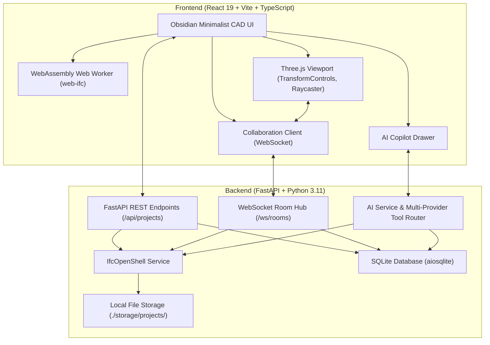

# IFC Editor — Autonomous Full-Stack OpenBIM Application

A high-performance, real-time collaborative OpenBIM web application for inspecting, modifying, and authoring Industry Foundation Classes (`.ifc`) building models. Features both a dark-mode **Obsidian Minimalist** CAD aesthetic and an immersive **Modern Glass — Soft / Elegant** spatial canvas with floating translucent frosted glass panels (see [MODERN_GLASS_UI_DESIGN.md](./MODERN_GLASS_UI_DESIGN.md)).

---

## 🌟 Key Features

1. **Lightweight 3D WebGL Engine & WebAssembly Web Worker**
   - Built on Three.js and `web-ifc` WebAssembly engine running in a **dedicated background Web Worker**.
   - Zero-copy transferable buffers keep the main UI thread completely responsive at 60fps.
   - Categorized architectural materials (Walls, Slabs, Columns, Doors, Windows) with silhouette edge highlighting on selection.

2. **Interactive 3D Spatial Transformations (Gizmo)**
   - Three.js `TransformControls` with Translate, Rotate, and Scale modes.
   - Configurable grid and angle snapping (`0.5m / 15°`).
   - Automatically synchronizes transformations back to backend IFC relative placements (`IfcLocalPlacement`, `IfcAxis2Placement3D`) via `ifcopenshell`.

3. **Property Set (Pset) Inspector & Editing**
   - Live numeric 3D position and rotation readout.
   - Inspects all IFC attributes, Property Sets (`Pset_WallCommon`, etc.), and quantities (Net Volume, Gross Area, Length).
   - In-place editing of property values (Boolean, Integer, Real, Label) persisted directly to the active `.ifc` file.

4. **Advanced BIM Inspection Suite**
   - **Orthogonal Section Planes**: Interactive clipping along X, Y, and Z axes with invert normal capability.
   - **3D Measurement Ruler**: Click-to-measure vertex-to-vertex 3D vector distances with real-time distance readouts.
   - **Camera Presets & View Modes**: Orthographic Top, Front, Side, and Isometric views; Solid, Wireframe, and X-Ray transparency styles.

5. **Real-Time Collaboration & Concurrency**
   - Multi-user FastAPI WebSocket rooms (`/ws/rooms/{project_id}`) with live user presence and color-coded avatar stack.
   - **Interactive Soft-Locking**: Selecting or editing an element acquires a temporary soft-lock on its `expressID`, preventing edit conflicts.
   - 60fps live transform matrix streaming across connected users with lerp interpolation.

6. **Multi-Provider AI Copilot with Tool Calling**
   - Natural language OpenBIM assistant accessible via the Copilot drawer.
   - Supports:
     - **Google Gemini**: `gemini-3.8-flash` (default), `gemini-3.8-pro`, `gemini-3.5-pro`
     - **Anthropic Claude**: `claude-3-7-sonnet`, `claude-3-5-sonnet`
     - **OpenAI**: `gpt-4o`, `gpt-4.5`, `o3-mini`
     - **Ollama / Local LLM**: Configurable base URL (e.g. `http://localhost:11434/v1`)
     - **Built-in Deterministic Engine**: 100% offline, zero-key tool execution
   - **Autonomous Tool Executions**:
     - `generate_building(specs)`: Parametrically generates multi-storey buildings with storeys, floor slabs, perimeter walls, and structural columns.
     - `transform_element(element_id, dx, dy, dz, rx, ry, rz)`: Moves or rotates elements by delta offsets.
     - `update_property(element_id, pset_name, property_name, value)`: Updates or adds property sets.
     - `query_model(query_type, filters)`: Queries element counts, storeys, and entity statistics.

7. **Bundled Architectural Sample Models & IFC Export**
   - 1-click onboarding templates:
     - **Duplex Residential Villa**: 2-storey residential villa with ground floor, first floor, partition walls, floor slabs, columns, and property sets.
     - **Modern Architectural Pavilion**: Open-span commercial pavilion featuring cantilever canopy roof, structural grid columns, and glass enclosure facades.
   - Full IFC Export: Generates 100% compliant IFC files preserving all updated geometry placements and modified properties.

---

## 🏗️ Architecture



---

## 🚀 Quick Start

### Prerequisites
- **Windows / Linux / macOS**
- **Python 3.11+**
- **Node.js 18+** & **pnpm**

### 1. Launch with One Command (Windows PowerShell)
```powershell
.\start.ps1
```
This script automatically:
1. Validates the Python 3.11 virtual environment (`backend/venv`).
2. Installs required Python and Node dependencies if missing.
3. Launches the FastAPI backend on `http://127.0.0.1:8000`.
4. Launches the Vite development server on `http://localhost:5173`.

### 2. Manual Startup

**Backend:**
```bash
cd backend
python -m venv venv
# Windows
.\venv\Scripts\activate
# Linux/macOS
source venv/bin/activate

pip install -r requirements.txt
# Windows (recommended): Selector event loop avoids the Proactor WinError 64 accept failure
.\venv\Scripts\python.exe run_server.py --reload
# Linux/macOS
uvicorn app.main:app --host 127.0.0.1 --port 8000 --reload
```

**Frontend:**
```bash
cd frontend
pnpm install
pnpm run dev
```

Open `http://localhost:5173` in your browser.

> **One backend per storage directory.** Startup takes an exclusive OS lock on
> `storage/.server.lock` (open issue 3.4) and fails with a critical log - `Another IFC Editor
> backend is already running` - when a second process tries to serve the same `storage/`. Use
> `--workers 1` (the default) and stop the previous backend before starting a new one. The
> guard is disabled only by `ENFORCE_SINGLE_WRITER = False` in `backend/app/core/config.py`.
>
> **Troubleshooting "502 Bad Gateway" / "Failed to obtain the API token":** the Vite dev server is
> up but nothing is listening on port 8000. On Windows an asyncio accept failure (`WinError 64`)
> can leave a zombie uvicorn that still holds `storage/.server.lock`, so a normal restart refuses to
> start. Run `.\scripts\stop_backend.ps1` (it stops only this app's uvicorn), then start the backend
> again with `.\venv\Scripts\python.exe run_server.py`. The upload dialog now reports this inline
> instead of leaving a stuck progress bar.
>
> `run_server.py` switches Windows to the **Selector** event loop. The default Proactor loop can
> raise `WinError 64` from its accept path after a WebSocket disconnects, leaving a process that
> holds the writer lock but no longer accepts connections (the 502 above). The Selector loop has
> been verified through an idle-heartbeat close (1001 at ~62 s) followed by a reconnect.

> **AI quota guard.** `POST /api/copilot/chat` and both `/api/copilot/models` routes admit 30
> requests per caller per minute in memory (`AI_RATE_LIMIT_*` in `backend/app/core/config.py`);
> beyond that they answer `429` with `Retry-After`. `/health`, project routes and the WebSocket
> are not metered.

---

## 🧪 Deterministic Quality Gates & Automated Tests

Run the complete verification suite with pytest and TypeScript compiler:

```bash
# Run backend test suite (Phase 1, Phase 3, Phase 5, Phase 6, Phase 7)
.\backend\venv\Scripts\pytest backend/tests/ -v

# Run frontend type check and production bundle
cd frontend
pnpm exec tsc --noEmit
pnpm run build
```

### Performance budget (open issue 2.4)

The ROADMAP performance budget is asserted by `backend/tests/perf/` against two datasets — the
tracked 47 MB `backend/app/samples/Ifc2x3_SampleCastle.ifc` (3,822 products) and a
50,000-product model generated once per session. Both go through the real API (`POST
/api/projects/upload` → `GET /api/projects/{id}/spatial-tree`), with `/health` polled
concurrently; nothing is mocked and no browser is needed.

```bash
# The budget itself (1-2 minutes). The `perf` marker is excluded from the default run.
.\backend\venv\Scripts\python.exe -m pytest backend/tests/perf -q -m perf -s

# The same measurements as a one-command local report (no pytest, exit code 1 on a miss)
.\backend\venv\Scripts\python.exe scripts/perf_budget.py

# Skip the generated 50k model on a small/loaded machine
.\backend\venv\Scripts\python.exe scripts/perf_budget.py --skip-synthetic
```

| Measurement | Budget | Where |
|---|---|---|
| Cold `GET /spatial-tree`, castle 47 MB | < 15 s | `test_castle_cold_spatial_tree_within_budget` |
| Warm `GET /spatial-tree` (model-cache hit) | < 300 ms (best of 3, all samples printed) | `test_castle_warm_spatial_tree_within_budget` |
| `/health` p95 while the cold tree runs | < 200 ms | `test_castle_health_p95_within_budget_during_cold_tree` |
| Model-cache hits increase on the warm read | miss +1, hit +1 | `test_castle_warm_read_increases_model_cache_hits` |
| Cold `GET /spatial-tree`, synthetic 50k | < 15 s | `test_synthetic_spatial_tree_within_budget` |
| `/health` p95 during the 50k tree | < 1,500 ms envelope (target 200 ms) | `test_synthetic_health_p95_within_budget` |

The 50k `/health` envelope is wider than the ROADMAP target on purpose: at 50k the request is
Python-bound (50,000 pydantic nodes) and `/health` waits on GIL handoff. The reasoning and the
measured values are in `backend/tests/perf/perf_support.py::SYNTHETIC_HEALTH_BUDGET_P95_MS` and
in `DEVELOPMENT_HANDOFF.md`.

The budget is wall-clock, so run it on an idle machine. CI runs it in its own `perf-budget` job
(`.github/workflows/qa-harness.yml`), separate from the fast unit job. First pixels, orbit fps
and hover-raycast latency are **not** asserted here — they need a real WebGL context and live in
the CDP browser tier (`python scripts/qa_runner.py run --tier key --browser`).

`GET /health` is public and now reports the STEP-04 pool/cache telemetry (open issue 2.5). Example
payload (the counters move with traffic; `entries` is a backwards-compatible alias of `models`):

```json
{
  "status": "ok", "version": "1.0.0", "ifcopenshell_version": "0.9.0",
  "database_ok": true, "project_count": 34, "timestamp": "2026-10-25T15:31:02+00:00",
  "ifc": {"max_workers": 2, "queued": 0},
  "model_cache": {"models": 2, "entries": 2, "max_models": 4, "bytes": 51808201,
                  "max_bytes": 805306368, "hits": 14, "misses": 3, "evictions": 0},
  "locks": {"registry_size": 2}
}
```

### Dependency CVE gate (open issue 3.7)

CI runs the two dependency audits in the `security-audit` job of
`.github/workflows/qa-harness.yml`: `pip-audit -r backend/requirements.txt` (fails on any known
vulnerable PyPI requirement) and `pnpm audit --prod --audit-level high` in `frontend/` (fails on
high/critical production dependencies). The same two commands are available locally as one
report:

```bash
# Run both audits and print a summary (exit 1 on findings, 0 when clean)
.\backend\venv\Scripts\python.exe scripts/security_audit.py

# The individual commands, if you prefer
.\backend\venv\Scripts\python.exe -m pip_audit -r backend/requirements.txt   # pip install pip-audit
cd frontend; pnpm audit --prod --audit-level high
```

A tool that is not installed is reported as `SKIPPED` with its install command rather than
passing silently. Neither command edits `requirements.txt` or `pnpm-lock.yaml`; a dependency bump
is a reviewed change.

### Test fixtures are local-only

The large IFC fixtures in `modelsfortests/` are intentionally **not tracked in git** (STEP-26 / F-057).
They stay on disk for this checkout, and any fixture-dependent test skips with a clear message when a
file is absent. To use a different directory, set `IFC_FIXTURES_DIR` before running pytest. The Vite dev
server serves `modelsfortests/*` at `/modelsfortests/*` for the federation sample loader; a production
build does not include them, and the UI now says so instead of failing silently.

No Git LFS or paid storage is used.

---

## 📂 Project Structure

```
├── backend/
│   ├── app/
│   │   ├── api/               # REST and WebSocket endpoints
│   │   │   ├── copilot.py     # AI Copilot endpoints (/api/copilot/chat)
│   │   │   ├── health.py      # System health and diagnostics
│   │   │   ├── projects.py    # Project CRUD, upload, export, samples
│   │   │   └── websocket.py   # Real-time multi-user WebSocket room hub
│   │   ├── core/              # Config and SQLite database initialization
│   │   ├── models/            # Pydantic schemas and data contracts
│   │   ├── samples/           # Bundled architectural IFC sample models
│   │   └── services/          # Business logic
│   │       ├── ai_service.py  # Multi-provider tool execution engine
│   │       ├── ifc_service.py # IfcOpenShell BIM operations
│   │       ├── project_service.py # Project lifecycle & audit trail
│   │       └── websocket_manager.py # Multi-user room manager & locks
│   └── tests/                 # Automated pytest test suites
├── frontend/
│   ├── src/
│   │   ├── components/
│   │   │   ├── copilot/       # AI Copilot drawer & settings modal
│   │   │   ├── modals/        # New project, sample loader, and upload modals
│   │   │   ├── properties/    # Property Inspector & Pset editor
│   │   │   ├── toolbar/       # Top navigation, project status, collaborator avatars
│   │   │   ├── tools/         # Section planes, measurement ruler, camera views
│   │   │   ├── tree/          # Spatial hierarchy tree navigator
│   │   │   └── viewer/        # Three.js 3D viewport & TransformControls
│   │   ├── services/          # REST and WebSocket collaboration clients
│   │   ├── types/             # TypeScript type definitions
│   │   └── workers/           # Dedicated WebAssembly worker (web-ifc)
│   └── public/
│       └── web-ifc.wasm       # Static WebAssembly binary asset
├── storage/                   # Project models and SQLite database
├── ROADMAP.md                 # Autonomous phase-lock roadmap
├── AGENTS.md                  # Agent QA Harness master runbook
├── project.config.md          # QA Harness product config and UI cues
├── test_cases.jsonl           # 372 structured QA test specifications
├── DEVELOPMENT_HANDOFF.md     # Tracked bugs, UX friction, and improvements
├── PATTERNS.md                # 3D WebGL, WASM, and Concurrency test patterns
└── start.ps1                  # Single native runner script
```

---

## 🧪 Agent QA Harness

The project integrates the file-based **[Agent QA Harness](https://github.com/jitangupta/agent-qa-harness)** for autonomous testing in real browser sessions using Google Chrome (or Microsoft Edge) via the Chromium DevTools Protocol (CDP):

- **Runbook ([`AGENTS.md`](./AGENTS.md)):** Mode detection, test execution protocol, real-time JSONL logging, spatial usability review, and development handoff tracking.
- **Specification ([`test_cases.jsonl`](./test_cases.jsonl)):** 372 granular test cases covering every product function across Project Lifecycle, 3D Viewport, Camera Presets, Hierarchy Tree, Raycasting & Gizmo transforms, Property Inspector & Psets, Sectioning, 3D Measurement, Category Filters, Omnibar, AI Copilot, Parametric CAD, Revit/Archicad/Tekla modification tools, and Real-Time WebSockets.
- **Two Execution Tiers:**
  - **Key Functionalities Tier (`--tier key`):** 123 critical end-to-end paths executed on **every test suite run**.
  - **Milestone Suite Tier (`--milestone` / `--tier full`):** Exhaustive check of all 246 milestone-tier product functions on **each major milestone**.
- **Backlog ([`DEVELOPMENT_HANDOFF.md`](./DEVELOPMENT_HANDOFF.md)):** Severity-graded (`P0`–`P3`) tracker for bugs, UX friction, and testability improvements.
- **QA Subagent (`.agents/subagents/qa-agent.md`):** Autonomous agent role for executing runs and auditing spatial ergonomics. *`.agents/` is a local checkout of the agent-skill library, installed per machine and gitignored — it is not part of the tracked product tree.*
- **QA Skill (`.agents/skills/agent-qa-harness/SKILL.md`):** Procedure guide for agent test authoring, runner execution, and reporting. *Same local checkouts as above.*

### CLI Runner Commands

```powershell
# Validate harness config and test cases (0 errors across 372 tests)
& .\backend\venv\Scripts\python.exe scripts/qa_runner.py check

# List test cases (filter by tier: key or full)
& .\backend\venv\Scripts\python.exe scripts/qa_runner.py list --tier key
& .\backend\venv\Scripts\python.exe scripts/qa_runner.py list --tier full

# Execute Key Functionalities tier in live Chrome browser (every run)
& .\backend\venv\Scripts\python.exe scripts/qa_runner.py run --tier key --browser

# Execute Major Milestone Suite in live Chrome browser (each milestone)
& .\backend\venv\Scripts\python.exe scripts/qa_runner.py run --milestone --browser

# Compile human-readable Markdown test report
& .\backend\venv\Scripts\python.exe scripts/qa_runner.py report
```

